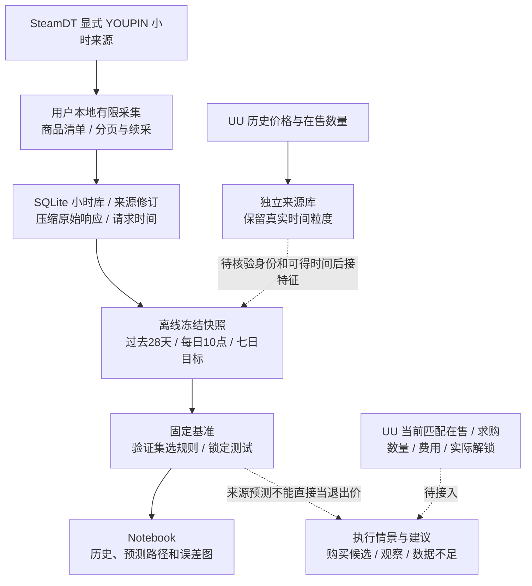

# 产品架构

版本 **architecture-1.12**；2026-10-19（北京时间）。冻结采集核心仍为 **0.3.5**，独立研究组件分别版本化。目标见 [PRODUCT](PRODUCT.md)，实际运行、分数和卡点见 [PROGRESS](PROGRESS.md)。

## 从来源到决策



实线已实现，虚线待接入。目前是 **L0 来源研究**，不是已验证盈利的交易系统。预测对应 SteamDT 来源参考价；真正的买入/出售判断还需同规格可匹配 UU 报价、费用、有效数量和实际可卖状态。持仓尚未解锁时只能更新风险；解锁、出售成交、结算分别记录，不能模拟 CD 内提前止损。

## 代码按功能分包

```text
scripts/
  notebooks/                         VS Code 用户入口
  config/                            商品种子、固定规范、受保护本地配置
  research/
    data/daily_samples.py            冻结快照、过去特征、序列和七日标签
    models/baselines.py               固定预测规则
    evaluation/baseline_report.py     数据校验、验证选择、锁定测试和产物
    evaluation/costs.py               已知报价/费用的保本情景
    visualization/forecast_charts.py  历史与预测图
  build_research_samples.py           兼容薄入口
  evaluate_research_baselines.py      评估薄入口
  steamdt_research.py                 有限采集组件，当前保持原版
  src/cs_youoweme/                    冻结0.3.5核心与历史实现
  tests/                             离线行为测试
```

Notebook 配置、调用和展示；计算逻辑放入包，避免在单元格复制实现。旧 CLI/Notebook 保持兼容，旧运行源码和产物不迁移、不重写。研究包从项目根导入；冻结核心继续按 scripts/src 打包。Python 3.11+；采集、样本与基准用标准库，图表用 Matplotlib，Notebook 需要 Python/Jupyter 内核。没有引入深度学习框架或数据库服务。

## 本地数据职责

| 位置（相对项目根） | 保存什么 |
| --- | --- |
| data/local/staging/steamdt/research_20261016_v1/ | registry.json精确身份；research.sqlite小时数据/修订/请求/任务；raw压缩原始响应；runs准确源码；reports覆盖和导出 |
| data/local/staging/steamdt/research_control/ | 跨运行共享配额、访问停止与锁，不得清理重置来绕过限制 |
| data/local/staging/uu_charts/ | UU图表各窗口响应、独立SQLite、数量/价格、来源和采集时间 |
| data/local/staging/research_samples/具体ID/ | 冻结小时输入、日级样本、28日序列、质量报告、规范与准确代码依赖 |
| data/local/artifacts/baseline_evaluations/具体ID/ | 规则、验证/测试预测、误差、最新七日参考路径及哈希清单 |
| data/local/reports/baseline_charts/具体ID/ | 冻结评估生成的PNG及独立绘图清单 |
| data/local/manifests/ | 文件版本、清理计划/回执与保留核对 |

**逐品价格要落盘，Notebook 内存不是唯一存储。** 后续要复算、续采、检查修订、验证预测和复盘执行。当前 UU 报价快照也应保存：明天的 K 线不能重建今天的价差、条件、数量和采集时刻。派生图/表可重建，但删除前仍核对用途；不能因结果相同就删旧真实运行。

原始响应压缩并按内容保存；小时数据按规格/来源/小时去重，修订保留。大数据、截图、登录配置和实验在私有忽略目录；Git 管代码和公开文档/清单。不读取、快照或哈希凭证。

## SteamDT 有限采集与续采

组件 steamdt-research-1.0；[Notebook](../scripts/notebooks/steamdt_research.ipynb)、[使用说明](usage/STEAMDT_RESEARCH.md)。新商品从配置起点回补，旧商品续接任务并重查近期：daily 7天、weekly 35天。每页事务保存游标，成功数据不重复插入；来源修订保留旧值。

默认串行5秒、单轮80请求/15分钟、共享300请求/滚动24小时，单响应2MiB、数据软预算128MiB。异常保存停止状态，不自动重试或清除共享限制。采集由用户显式本地运行，不代开持续采集、后台服务或定时任务。

research_hourly_latest 按规范小时取得最近来源版本，保留原始秒偏移；导出排除当前未完成小时。4h/日/周按北京时间聚合首开、最高、最低、末收；缺小时标不完整，量额任一空则聚合空。源端断档不造波动。已有一次真实跨日增量与有限分页验证，不等于长期稳定；逐轮检查新鲜度、失败、任务、缺口和修订。

## 样本与预测评估

cyrex-daily-samples-1.1 从保存报告的请求上限内选择版本，SQLite只读；旧1.0候选继续可读。每天北京时间10:00，以此前28天672小时构成28个24小时段。价格输入缺一小时不进入首版规则，来源量额辅助保留，空值不补0。

目标是 t+168h 前最后一个完整小时来源收盘；未来不足、缺口、跨分组边界的七日标签分别标记。固定日期 train/validation/test 加七日标签隔离，不随机打散。见 [样本规范](data/CYREX_DAILY_SAMPLES.md)。

基准在评分前固定：价格持平，以及按过去3/7/14天对数变化率外推。验证集按七日价格 MAE 选一条，锁定后查看测试集，并与持平比较。报告 MAE、RMSE、MAPE、收益误差和相对持平的误差改善；不把价格误差算成交易利润。每次评估另建ID，不覆盖旧结果。

测试图按目标时刻对齐真实价/提前七日预测；最新图展示28天历史与day0–7预测点。没有未来真实曲线时不编造；缺小时断线，外推不制造日内波动。固定10点示例在实际收到数据后才生成，不冒充当日10点已发的实盘预测。见 [图表说明](usage/FORECAST_DASHBOARD.md)。

没有拟合深度学习或正式交易模型。回顾历史 available_at 未核验，快照可能含后来修订，training_approved=false；正确时间划分仍不等于严格PIT回测。每日七日标签重叠，不当作独立交易次数。

## UU 补充与执行边界

UU价格 orderType=1、在售数量11；同名price随指标变义，分别存储。页面支持价格7/30/90天/半年，数量7/15/30天，间隔以实际响应为准。数量不是成交量，不能乘价格还原成交额。两源不按行号拼接或平均；补充特征要按决策时刻找过去已知值，保留年龄、缺失及来源。

用户44828纯脚本七组已成功，凭证失效、多商品、多轮及统计仍待验收。配置由用户本地维护，旧访问停止证据保留。见 [纯脚本](usage/UU_DIRECT_COLLECT.md)、[图表指标](data/UU_HISTORY_CHART.md)、[来源对齐](data/SOURCE_ALIGNMENT_PLAN.md)。BUFF未接入当前流程。

次时代普通崭新按用户确认，以标准磨损研究，暂不单独建细磨损/普通贴纸特征；截图232/228不是实时价，不套用历史成本，其他六品不继承该假设。

完整决策还缺当前匹配UU报价、适用费用、实际收货/解锁/出售/结算，以及验证过的风险/仓位规则。费用未知不默认0，历史缺报价不虚构净收益；execution_eligible=false不因基准完成而升级。

## 版本与恢复

每次操作更新三大文档；每个文件/目录用途与SHA-256见 [文件索引](governance/FILE_INDEX.md)。候选、评估和图有各自清单与latest指针。清理仅删有登记/恢复依据的缓存或确证冗余，保留真实数据、源码快照、用户Notebook输出和访问控制。历史架构正文由本地Git保存，不并列维护第二份当前架构。
