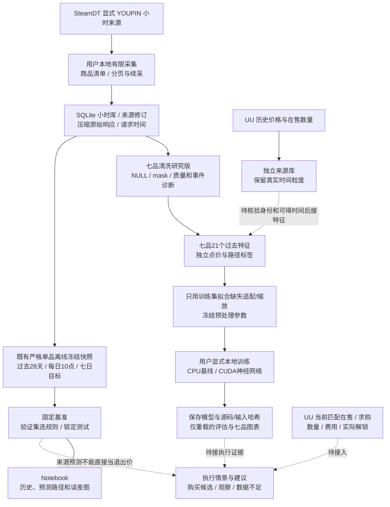

# 产品架构

版本 **architecture-1.18**；2026-10-21（北京时间）。冻结采集核心仍为 **0.3.5**，独立研究组件分别版本化。目标见 [PRODUCT](PRODUCT.md)，实际运行、分数和卡点见 [PROGRESS](PROGRESS.md)。

## 从来源到决策



实线已实现，虚线待接入。目前是 **L0 来源研究**，不是已验证盈利的交易系统。预测对应 SteamDT 来源参考价；真正的买入/出售判断还需同规格可匹配 UU 报价、费用、有效数量和实际可卖状态。持仓尚未解锁时只能更新风险；解锁、出售成交、结算分别记录，不能模拟 CD 内提前止损。

## 代码按功能分包

```text
scripts/
  notebooks/                         VS Code 用户入口
  config/                            商品种子、固定规范、受保护本地配置
  research/
    data/clean_hourly.py              七品小时清洗、缺失与因果质量诊断
    data/daily_samples.py             旧单品严格样本、序列和七日标签
    data/seven_samples.py             清洗库到七品过去特征、独立点/路径标签
    data/training_data.py             冻结链核验、过去672小时序列与预测字段白名单
    data/model_preprocessing.py       train-only缺失适配、缩放、mask和JSON持久化
    models/baselines.py               固定预测规则
    models/classical.py               持平、Ridge、有界ARIMA与LightGBM
    models/neural.py                  DLinear/LSTM/Transformer/门控cross attention
    models/foundation.py              可选本地Chronos适配，未验证真实权重
    evaluation/baseline_report.py     数据校验、验证选择、锁定测试和产物
    evaluation/seven_training.py      prepare/显式训练/重载评估/七品误差图
    evaluation/costs.py               已知报价/费用的保本情景
    visualization/forecast_charts.py  历史与预测图
  clean_steamdt_data.py               清洗薄入口
  build_research_samples.py           旧单品兼容薄入口
  build_seven_samples.py              新七品特征/标签薄入口
  evaluate_research_baselines.py      评估薄入口
  train_seven_models.py               新七品训练/评估薄入口
  steamdt_research.py                 有限采集组件，当前保持原版
  src/cs_youoweme/                    冻结0.3.5核心与历史实现
  tests/                             离线行为测试
```

Notebook配置、调用和展示；计算逻辑放入包。旧CLI/Notebook保持兼容，旧运行源码和产物不迁移、不重写。研究包从项目根导入；冻结核心继续按scripts/src打包。Python3.11+；采集/样本核心用标准库，图表用Matplotlib。新增research可选依赖为NumPy、scikit-learn、statsmodels和LightGBM，neural可选依赖为PyTorch；不把它们加入采集核心的强制依赖，也不自动安装或替换用户CUDA环境。Notebook需要匹配的Python/Jupyter内核。

## 本地数据职责

| 位置（相对项目根） | 保存什么 |
| --- | --- |
| data/local/staging/steamdt/research_20261016_v1/ | registry.json精确身份；research.sqlite小时数据/修订/请求/任务；raw压缩原始响应；runs准确源码；reports覆盖和导出 |
| data/local/staging/steamdt/research_control/ | 跨运行共享配额、访问停止与锁，不得清理重置来绕过限制 |
| data/local/staging/uu_charts/ | UU图表各窗口响应、独立SQLite、数量/价格、来源和采集时间 |
| data/local/datasets/steamdt_clean/具体ID/ | 全部来源版本、小时网格、合法价格/NULL/mask、事件诊断、质量窗口、报告及源码规范 |
| data/local/datasets/seven_daily/具体ID/ | 日级samples.sqlite、分开的features/labels、schema、父清洗/规范/准确源码与产物哈希 |
| data/local/artifacts/seven_training/prepared/具体ID/ | train-only预处理器、特征/序列字段与item编码、规范、输入/父版本及schema哈希引用和准确源码 |
| data/local/artifacts/seven_training/experiments/具体ID/ | 本地模型参数、预处理副本、配置、环境、训练历史、验证选择、成功/失败清单及源码 |
| data/local/reports/seven_training/具体ID/ | 重载评估分数、逐品预测CSV、价格/误差PNG、报告和独立哈希清单 |
| data/local/reports/seven_samples/具体ID/ | 独立重算真实特征/标签/资格、1198旧资产保留与Notebook默认只读验证 |
| data/local/reports/cleaning_reviews/具体ID/ | 清洗实际值/窗口/哈希与Notebook默认只读行为复核 |
| data/local/staging/research_samples/具体ID/ | 冻结小时输入、日级样本、28日序列、质量报告、规范与准确代码依赖 |
| data/local/artifacts/baseline_evaluations/具体ID/ | 规则、验证/测试预测、误差、最新七日参考路径及哈希清单 |
| data/local/reports/baseline_charts/具体ID/ | 冻结评估生成的PNG及独立绘图清单 |
| data/local/manifests/ | 文件版本、清理计划/回执与保留核对 |

**逐品价格要落盘，Notebook 内存不是唯一存储。** 后续要复算、续采、检查修订、验证预测和复盘执行。当前 UU 报价快照也应保存：明天的 K 线不能重建今天的价差、条件、数量和采集时刻。派生图/表可重建，但删除前仍核对用途；不能因结果相同就删旧真实运行。

原始响应压缩并按内容保存；小时数据按规格/来源/小时去重，修订保留。大数据、截图、登录配置和实验在私有忽略目录；Git 管代码和公开文档/清单。不读取、快照或哈希凭证。

## SteamDT 有限采集与续采

组件 steamdt-research-1.0；[Notebook](../scripts/notebooks/steamdt_research.ipynb)、[使用说明](usage/STEAMDT_RESEARCH.md)。新商品从配置起点回补，旧商品续接任务并重查近期：daily 7天、weekly 35天。每页事务保存游标，成功数据不重复插入；来源修订保留旧值。

默认串行5秒、单轮80请求/15分钟、共享300请求/滚动24小时，单响应2MiB、数据软预算128MiB。异常保存停止状态，不自动重试或清除共享限制。采集由用户显式本地运行，不代开持续采集、后台服务或定时任务。

research_hourly_latest 按规范小时取得最近来源版本，保留原始秒偏移；导出排除当前未完成小时。4h/日/周按北京时间聚合首开、最高、最低、末收；缺小时标不完整，量额任一空则聚合空。源端断档不造波动。已有一次真实跨日增量与有限分页验证，不等于长期稳定；逐轮检查新鲜度、失败、任务、缺口和修订。

2026-10-19有限缺口对照：次时代在7月23日20点至24日11点前、24日22点至25日9点前共缺26小时。旧页和本次同参/换maxTime新页都只返回694条（覆盖720小时），未找回这26小时；全数组解析与原始→规范库小时并集一致，不能归因于开发者工具折叠、分页接缝或本地漏入库。最新页720小时完整。该结论只针对实际核验的网页K线端点与请求，用户网页也观察到跳时；该有限核验未穷尽所有端点或绘图实现。原库、旧候选/评估不变，新请求/raw存工作区gap_audit_20261019_v1/network；复用共享锁/配额/停止，最多6请求、间隔5秒，无自动重试。

## 七品清洗层

组件steamdt-hourly-cleaning-1.0、规范steamdt-cleaning-spec-1.0；入口[Notebook](../scripts/notebooks/steamdt_cleaning.ipynb)、[字段](data/STEAMDT_CLEANING.md)、[2025–2026方法依据](research/DATA_METHODS_20261019.md)。原库mode=ro，从完成报告的cap199/截止10月19日12点冻结；本次隔离探测的新两小时不无声并入。

清洗SQLite保留81407来源版本、81397真实观察小时，扩展84924行规则小时网格；无数据行全部NULL、observed=0。3527空白分为流金首次观察前3289小时和七品内部缺238小时，不能把前者当共同接口掉数。原始库与旧候选/评估保持不变。

时间/身份结构不符停止；非法价格/OHLC/量额字段隔离，原值仍在source_versions。真实跳变不删、不平滑、不截尾，预设30%涨跌/振幅与过去168小时MAD标记仅诊断，未认定操盘。MAD不含当前收益，零MAD不造分母，缺小时不算跨缺口一小时收益。

input_quality_windows仅计算过去28天覆盖和最近24h完整度，保留严格/95%门槛对照，没有未来标签；它不是预测特征或训练资格。新增seven_samples已显式接入本版clean.sqlite；既有Cyrex builder仍读旧原库并维持严格规范。清洗本身不变，新特征/标签另建版本，没有安装深度框架、插补模型或重算旧预测。

## 七品特征与标签连接

组件seven-daily-samples-1.0，规范seven-daily-spec-1.0；[Notebook](../scripts/notebooks/seven_daily_samples.ipynb)、[字段与使用](data/SEVEN_DAILY_SAMPLES.md)。build显式选clean ID并核验其全部输出；父库mode=ro，完整网格/身份校验，构建前后哈希一致。新SQLite/CSV按ID冻结，失败不更新latest，已有版不覆盖，所有实际代码依赖、规范、schema和父manifest准确保存。

每品每日10点，用过去28天672小时。21个x包括参考价、1/3/7/14日收益、观察值MA比例、相邻有效小时log收益标准差、范围/尾部、覆盖/最长缺口/年龄及同日其他品过去7日收益中位数/数量。缺口不桥接小时收益，不插补；量额、missing_kind、修订编号和未来资格不作x。跨品成员只按当时过去收益可用性，不看未来标签。

点目标是t+168h前完整小时close（bucket=t+167h）；成熟且目标有效即可有价格标签，参考价缺失时相对收益仍空。路径低/高及相对收益只有未来168h全部真实有效才提供，不能称最大回撤。strict与95%/最近24h输入并列，分别计算点/路径资格，标签触及下一日期分界隔离。所有品同日同split，旧test仅探索，历史available_at仍未知。

冻结样本保留原始NULL。features.csv只有键/split＋21个明确x；labels.csv另含y与未来状态/资格。模型使用白名单，不能整表自动选数值列。新训练适配层独立处理这些缺失，不改样本或旧评估。

## 七品本地训练与重载评估

组件seven-training-1.1、规范seven-training-spec-1.1；[修复版Notebook](../scripts/notebooks/seven_model_training_v1_1.ipynb)、[操作说明](usage/SEVEN_MODEL_TRAINING.md)。入口分prepare、train、evaluate：默认全部关闭，用户明确选择后运行。训练授权记录为2026-10-21回顾研究，不修改父样本的training_approved=false，也不升级UU执行资格。

training_data核验样本/父清洗全部outputs、源码快照、规范、schema、父manifest和只读SQLite完整性；验证共同日期split、168小时标签与purge。默认quality点任务为train1,714、validation588、test_exploratory707。测试行在原库仍叫test，接口专门标记为探索；没有随机拆分或把同日不同品分入不同组。

表格输入21项x；预处理只在eligible、未purge的train行拟合列median，再在填充后的train上拟合mean/std，附21个缺失mask和7个训练商品one-hot，共49列。全缺失训练列显式采用0作为模型输入fallback并保留mask，常量列scale=1；未知商品拒绝预测。树模型使用21项原NaN＋7项one-hot，共28列。统计参数、字段顺序、商品身份、fit行键及哈希保存JSON，transform和evaluate不重新fit，y_return_7d不缩放。

序列严格取[t-672h,t)的672个小时：log(close/reference)、相邻真实一小时log收益、log(high/low)。缺失NaN不插值，不跨缺口计算收益，窗口首收益也为空；同样用训练统计适配并附3个mask，共6通道。预测输入显式去掉y、target、未来资格和诊断元数据；训练标签在调用模型时独立追加。

CPU候选为持平、Ridge、有界ARIMA、LightGBM；CUDA候选为DLinear、LSTM、小Transformer、门控LSTM–Transformer cross attention。神经网络统一使用序列＋表格输入，训练MSE、验证MAE早停并保存最佳.pt权重。seven-neural-1.1默认在CUDA用float32；amp_float16改为显式可选，遇非有限梯度由GradScaler跳过更新并回退scale，计数记录在历史中；float32及正常裁剪仍保留有限性检查，持续失败停止，不删市场样本。门控结构从毕设思路改写为本任务联合训练，不加载交通预测权重。Chronos只提供显式本地权重的可选适配，未验证真实权重、不在默认模型列表。

每轮保存模型、预处理、配置/字段、源与父清单哈希、准确源码、环境和训练历史。preprocessor.json记录特征/序列顺序、item编码和训练行键；SQLschema保留在不可变dataset中，由provenance按哈希引用，不重复复制或改写。加载时核验哈希及当前运行源码与快照，代码漂移即拒绝。失败保留状态及错误，不自动重试或静默更换设备；部分失败实验保留manifest，完整实验才进入统一评估。旧实验ID不覆盖，重跑另建ID。

用户两轮v1真实训练仅持平完成，四神经模型在第一轮完成前因fp16梯度非有限被裁剪检查停止，实验为partial；统一评估因此拒绝。这不代表数据缺失或需要重抓。旧实验、v1预处理及用户Notebook保留，修复版另用seven_prep_20261021_v2和新Notebook；源码变更后不能改旧manifest绕过冻结校验，必须重启内核并新建实验。

选模只按validation收益MAE，价格由reference×(1+预测收益)还原；重载评估输出价格MAE/RMSE、MAPE、偏差、方向正确率及逐品图。图上的每个预测点来自七日前的origin，缺日期保持断线；本版没有训练可靠区间，也没有预测期间每小时路径。旧test需要显式探索开关。未来仍需滚动时间验证、新前向留出和UU执行成本对照。

## 旧单品样本与预测评估

cyrex-daily-samples-1.1 从保存报告的请求上限内选择版本，SQLite只读；旧1.0候选继续可读。每天北京时间10:00，以此前28天672小时构成28个24小时段。价格输入缺一小时不进入首版规则，来源量额辅助保留，空值不补0。

目标是 t+168h 前最后一个完整小时来源收盘；未来不足、缺口、跨分组边界的七日标签分别标记。固定日期 train/validation/test 加七日标签隔离，不随机打散。见 [样本规范](data/CYREX_DAILY_SAMPLES.md)。

图中约一个月的断线是完整窗口筛选的放大结果：26个源小时缺口影响29个决策日的28天输入和8个决策日的七天标签，其中1天重合，合计排除36个测试时点；按目标日期为7月24日至8月28日。不是整段36天无行情，也非模拟缺失。本次只诊断，不降低完整性要求或填造输入/标签；后续如改变缺失处理必须另定样本规范和评估版本。

基准在评分前固定：价格持平，以及按过去3/7/14天对数变化率外推。验证集按七日价格 MAE 选一条，锁定后查看测试集，并与持平比较。报告 MAE、RMSE、MAPE、收益误差和相对持平的误差改善；不把价格误差算成交易利润。每次评估另建ID，不覆盖旧结果。

测试图按目标时刻对齐真实价/提前七日预测；最新图展示28天历史与day0–7预测点。没有未来真实曲线时不编造；缺小时断线，外推不制造日内波动。固定10点示例在实际收到数据后才生成，不冒充当日10点已发的实盘预测。见 [图表说明](usage/FORECAST_DASHBOARD.md)。

旧单品链路未拟合深度模型；新增七品训练走上面的独立入口。回顾历史available_at未核验，快照可能含后来修订，源training_approved=false保持原值；正确时间划分仍不等于严格PIT回测。每日七日标签重叠，不当作独立交易次数。

## UU 补充与执行边界

UU价格 orderType=1、在售数量11；同名price随指标变义，分别存储。页面支持价格7/30/90天/半年，数量7/15/30天，间隔以实际响应为准。数量不是成交量，不能乘价格还原成交额。两源不按行号拼接或平均；补充特征要按决策时刻找过去已知值，保留年龄、缺失及来源。

用户44828纯脚本七组已成功，凭证失效、多商品、多轮及统计仍待验收。配置由用户本地维护，旧访问停止证据保留。见 [纯脚本](usage/UU_DIRECT_COLLECT.md)、[图表指标](data/UU_HISTORY_CHART.md)、[来源对齐](data/SOURCE_ALIGNMENT_PLAN.md)。BUFF未接入当前流程。

次时代普通崭新按用户确认，以标准磨损研究，暂不单独建细磨损/普通贴纸特征；截图232/228不是实时价，不套用历史成本，其他六品不继承该假设。

完整决策还缺当前匹配UU报价、适用费用、实际收货/解锁/出售/结算，以及验证过的风险/仓位规则。费用未知不默认0，历史缺报价不虚构净收益；execution_eligible=false不因基准完成而升级。

## 版本与恢复

每次操作更新三大文档；每个文件/目录用途与SHA-256见 [文件索引](governance/FILE_INDEX.md)。候选、评估和图有各自清单与latest指针。清理仅删有登记/恢复依据的缓存或确证冗余，保留真实数据、源码快照、用户Notebook输出和访问控制。历史操作日志集中在docs/releases/WORK_LOG_20261014_20261019.md；下一步的唯一优先级和验收表见PROGRESS。公开代码/文档在planning/uu-research-reset分支迭代，私有数据/凭证/实验不上传；不自动合并、强推或打release标签。
