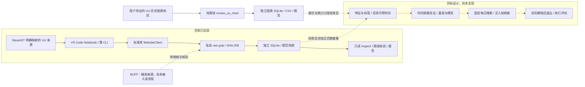

# CS_YouOweMe 架构与数据口径

| 字段 | 当前值 |
| --- | --- |
| doc-version | architecture-1.1 |
| updated | 2026-10-14（Asia/Shanghai） |
| 工程 / 目录 / 制度 | 0.3.5（本地未发布） / layout-1.0 / management-1.3 |

本页解释当前实现、数据如何流动，以及后续模型与执行评估的边界。[PRODUCT](PRODUCT.md)说明目标与研究方案，[PROGRESS](PROGRESS.md)记录成果、证据和下一步。首批目标为 UU 百元普通枪皮，采用七日 CD 解锁后尽快退出的策略；当前实现仅支持来源观察、有限采集和离线验收。

## 1. 当前实现与目标流程

实线部分已具备工程实现，虚线部分需要来源与用途验收。当前已验收正式数据集 **0**、交易模型 **0**；已有试跑 SQLite、原始响应和源码快照，不等于已完成模型数据集。用户连续观察只完成首轮后中断，真实 24 小时稳定性尚未通过验收。

## 2. 入口与技术栈

| 实现 | 真实职责 |
| --- | --- |
| `scripts/notebooks/uu_observe_24h.ipynb` | 用户在 VS Code 本机选择 Python kernel，配置、新建或恢复运行、前台采集、查看结果 |
| `scripts/observe_uu_24h.py` | 薄 CLI：`--new` 新建并采集，`--resume` 继续原窗口，`--status` 只读查看 |
| `scripts/src/cs_youoweme/history/observe.py` | `create_run` 固定范围与窗口；`collect` 调度和落盘；`inspect_run` 只读状态；`load_last_run` 校验恢复指针 |
| `collectors/website.py` | SteamDT 匿名只读客户端、允许端点、请求间隔、响应大小和错误停止 |
| `history/store.py`、`history/schema.sql` | SQLite、压缩原始响应、请求记录和单库工作锁 |
| `history/verification.py`、`normalize.py` | 身份与数值规范、null/零值、来源质量标记；不能把解析成功升级为执行准入 |
| `scripts/pilot_uu_day.py`、`verify_uu_fields.py`、`review_uu_verification.py` | 独立有限试跑、字段补查与离线复核，具体参数与结果随运行保存 |
| `scripts/review_uu_chart.py` | 纯离线读取用户导出，显式指定模板/指标/窗口，检查真实时间间隔并保存独立 SQLite/CSV；不调用市场、不修改旧运行 |

采集器使用 **Python 3.11+ 标准库**，`pyproject.toml` 当前没有第三方运行依赖。实际使用 `urllib`、`sqlite3`、`gzip`、`hashlib`、`json`、`csv`、`decimal` 等；本地 Git 用于记录代码基线。VS Code 的 Python/Jupyter 扩展和 Python kernel 属于 notebook 运行环境。当前未引入数据库服务器、pandas、机器学习库或后台服务。

Notebook 与 CLI 复用同一实现。前台采集需要电脑保持唤醒、联网以及进程/kernel 运行；关闭屏幕可以继续，睡眠和停机会造成缺采。程序不修改电源设置。用法见 [24 小时说明](usage/OBSERVE_24H.md)。

## 3. 数据来源与身份

| 来源/字段 | 当前证据与允许用途 |
| --- | --- |
| SteamDT YOUPIN Kline | 有显式 UU 平台参数的小时行情，已做有限历史试跑；价格及可空来源量额仅限 L0，不证明实际 UU 成交量或结算 |
| SteamDT ITEM 与 market-comparsion | `youpin`、名称“悠悠”、商品链接/模板形成平台证据；当前连续观察采集商品报价与来源汇总在售/求购报价、数量和更新时间 |
| SteamDT 来源逐笔 | 代码 1 显示为 Steam，0/2/3 为第三方未知且存在推算口径，不继承 Kline 的 UU 平台选择，不标为 UU 真实订单 |
| UU 网页历史图表 | 用户请求与两份响应支持 orderType=1 成交价格、11 在售数量；time 为毫秒、price 随指标改变语义。身份、统计与历史可得时间未验收 |
| BUFF | 用户截图显示成交记录/走势入口和登录提示，仅作辅助；不能替代 UU 执行数据 |

商品使用精确英文名称、普通/特殊版本和标准磨损档；SteamDT itemId、UU templateId 与单件挂牌 ID 分别保存。流金王朝是 **The Oligarch**，黄金藤蔓是 **Gold Arabesque**，不混用身份。首批每品一个标准磨损档，进一步核对同档内 float、模板、贴纸和求购条件的可比性。

本次 15 天数量响应有 93 点，相邻均为 4 小时；30 天价格响应有 169 点，时间间隔不固定。7 天每小时、90 天及半年每日 2 次仍只是用户观察；不能统一按页面天数预设频率或按 blockNum 推算。两个指标保留各自时间网格，不按行号拼接或插值成真实小时采样。在售数量是挂牌观察，不是成交量；价格与数量不能相乘推导成交额。templateId=980 由用户请求提供，完整身份尚未核验；截图参考 44.4 元只作技术例子，不加入百元名单。

Edge 浏览器工具仍无法读取会话，但用户手动导出已经支持离线字段核验；无需为此读取账号凭证。UU 旧 429 入口保持停止，本次没有发送请求；后续自动采集权限与有限预算仍待确认。见 [图表口径](data/UU_HISTORY_CHART.md)、[导出用法](usage/UU_CHART_EXPORT.md)与[字段契约](data/UU_FIELD_CONTRACT.md)。

## 4. 当前连续观察的调度与恢复

现有代码固定流金王朝久经和印花集崭新两个验证规格。印花集已退出新首批，只保留属性限制反例；不得把新候选插入旧运行。新百元名单经复核后另建运行和代码版本。

默认在创建时固定 24 小时窗口，60 分钟间隔，共 **24 个时点 × 2 规格 = 48 个计划样本**。从创建时采样至第 23 小时，等待原第 24 小时截止，截止时不再采样。连续观察仅请求 ITEM、比较接口及必要的来源时钟配置，不请求 Kline、逐笔或 UU 直接 API；因此不能还原采样之间的高低点。

每个样本按 `(slot,item)` 唯一记录。请求前持久登记尝试，成功后记录原始响应、规范快照和返回可得时间；中断可继续原窗口，已成功样本不重复采。恢复跳过已错过时点，缺采保留为 missed，不用现在的快照回填。冻结 manifest 或实际采集源码哈希变化会拒绝恢复，单库工作锁防止两个采集进程同时写入。

默认请求预算 **144 次**（包含来源时钟请求），单响应最多 **2 MiB**，运行数据目录采用 **64 MiB 软停止预算**。最后一个响应或数据库记账可能略超后停止，准确源码快照另计。401/403/429、认证/风控或数据结构校验失败会保存停止状态；同一运行恢复不自动重试终止入口。普通传输失败记录失败样本，下一次按后续采样时点尝试，不即时循环重试。

`inspect_run` 以 SQLite `mode=ro` 读取，并能看到活动库的 WAL 进度，不访问网络、不启动采集。通用 `Store` 初始化会写 WAL/schema，并可能执行旧迁移；查看旧数据库不能把它当成只读连接，也不在活动写入时只复制主库文件。

## 5. 存储与追溯

每次运行在 `data/local/staging/steamdt/<run_id>/` 建独立资产，不追加旧市场库：

| 产物 | 用途 |
| --- | --- |
| `observations.sqlite` | 请求、采样状态、控制状态与规范快照；主要结构化存储 |
| `raw/<哈希前缀>/<SHA-256>.json.gz` | 压缩完整来源响应，按原始字节哈希去重；不改写原值 |
| `manifest.json` | 冻结窗口、规格、预算、schema、代码基线和内容哈希 |
| `reports/summary.json`、`summary.md` | 当前覆盖、状态、请求、质量标记与磁盘摘要 |
| `tables/source_snapshots.csv` | 便于查看的导出；不能替代 SQLite 与原始响应 |
| `scripts/local/pilot_sources/<run_id>/` | 实际执行代码及依赖的准确内容版本，保持私有 |
| `data/local/manifests/uu_observe_last_run.json` | 指向具体运行并校验 manifest 的恢复指针 |

来源请求时间、响应返回时间、来源更新时间、历史事件/采样时间分别记录。金额保留数值语义，null 不补零，零值不当作缺失；原始字节支持复核数值精度和来源格式。求购高于在售保留原值并标 `crossed_source_quotes`，不自动改价或生成套利标签。

用户图表离线核验另存 `data/local/staging/uu_charts/<批次>/`，包含 response_input.json、manifest.json、report.json、points.csv、chart_review.sqlite、review_source.py。价格附件保留准确输入字节；聊天数量只保存明确标注的 time/price 人工投影，其哈希不能冒充完整原始响应哈希。SQLite 使用精确文本保存价格、整数保存数量，null 与零分开；独立库不调用 Store 或迁移旧库。来源 sourceType 保留原值，不继承 SteamDT 的平台分类；商品身份及价格统计含义明确标为未验证。

用户保存的 Notebook 输出、已有库和冻结源码属于已执行证据，文档重组不清空或覆盖。原始数据、截图、私有源码和运行日志留在忽略目录；工程源码及说明用本地 Git 管理，凭证不打印、快照或提交。

## 6. 后续特征、模型与执行边界

以下四层均为目标设计，尚未实现：

1. **特征与标签**：来源验收后冻结正式数据集，统一身份、窗口和缺失规则。较长历史可按统一日粒度建基准，近期小时快照另存；不把今天才取得的历史值假定成过去可见信息。
2. **时间验证与模型**：先简单规则和回归/分类基准，再决定是否引入复杂模型。按时间前推、处理重叠标签与名单选择偏差，冻结每次输入、成本假设和代码版本。
3. **每日决策**：拟在固定时点使用完整昨天序列与当前已可得快照推断，准备买入前再刷新报价和求购条件。当天结束才知道的收盘、高低价或回填值不能进入更早决策。
4. **执行评估**：按实际收货、保护解锁及最早可卖状态安排七日 CD 后尽快退出，出售等待、结算、资金复用与提现分别记账；未退出库存和失败退出保留，不自动执行真实交易。

来源价格变化可用作 L0 预测目标，不能直接作为可执行净收益。先验证普通在售能否匹配求购的 float/模板/贴纸条件，再讨论可卖价格和深度；来源汇总数量不等于该价位可成交件数。印花集高价求购限 0–0.01 的截图是属性不匹配反例，未显示条件标签也不证明没有限制。

价差已经包含在实际买卖价中时不重复扣，提现仅在资金实际退出事件记账，平台内复用不机械地每轮再扣提现费。平台现行结算、费用及账户适用规则仍待核验。L1 模拟执行与 L2 实际订单/现金账本未通过准入，不能用估计退出价标成已成交利润。

## 7. 目录与版本

| 主体 | 当前与后续职责 |
| --- | --- |
| `scripts/` | Notebook、薄 CLI、源码、配置、离线检查、SQL 与 hooks；后续特征/模型/决策代码仍集中此处，当前相关正式模块未实现 |
| `data/local/` | 私有 raw、试跑 staging、名单、清单与证据；后续正式 datasets、实验 artifacts/reports 按独立 ID 冻结，不预建空资产 |
| `data/samples/` | 旧公开样本冻结待审查，不作为正式训练集 |
| `docs/PRODUCT.md` | 目标、范围、研究方案与验收要求 |
| `docs/ARCHITECTURE.md` | 实现结构、数据流、字段与技术边界 |
| `docs/PROGRESS.md` | 成果、证据、停止点与下一步 |
| `docs/data/`、`usage/`、`governance/`、`research/` | 字段、操作、管理和专项证据附件；不另立与三个主入口冲突的当前计划 |

工程版本 0.3.5、SQLite 基础 `user_version=2`、观察 schema `observe-1.0`、字段契约 `uu-field-contract-1.1`、目录与文档版本各有职责。未来 dataset/model ID 只在资产创建并冻结时赋予，不能用代码版本代替；旧运行按创建时记录的契约与准确源码解释，不随当前说明改写。

维护规则：实现改变更新本页；每次成果写入 [PROGRESS](PROGRESS.md)。

独立离线图表工具版本为 uu-chart-review-1.0；现有连续观察的十份冻结源码及包版本 0.3.5 保持不变，不影响用户原运行恢复校验。
